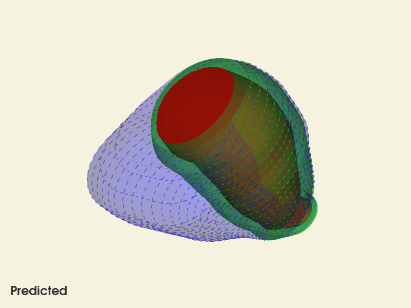
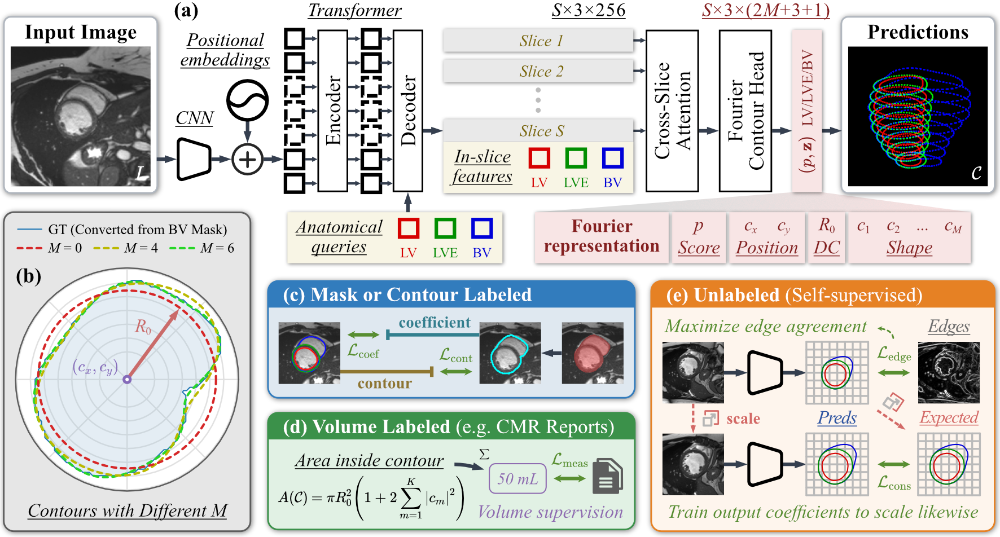

<p align="center">
  <h1 align="center">Fourier Contour Learning for Efficient and Traceable Cardiac MRI Quantification</h1>
  <p align="center">
    Yi Yu<sup>1*</sup>, Zhenyu Bu<sup>1*</sup>, Ziyu Zhang<sup>2</sup>, Yixuan Liu<sup>1</sup>, Aotian Chen<sup>1</sup>, James Mihalich<sup>1</sup>, Parker Martin<sup>1</sup>, Xia Ning<sup>1</sup>, Yuchi Han<sup>1</sup>, Yuan Xue<sup>1†</sup>
  </p>
  <p align="center">
    <sup>1</sup>The Ohio State University &nbsp;&nbsp; <sup>2</sup>Nanjing University &nbsp;&nbsp; * Equal contribution. † Corresponding author: xue.643@osu.edu
  </p>
  <div align="center">
      <!-- <a href='https://arxiv.org/abs/2608.00145'></a> -->
  </div>
  <p align="center">
    If you find our work helpful, please consider giving us a ⭐.
  </p>
</p>

<p align="center">
  
</p>

## Abstract

Automated cardiac MRI quantification is commonly framed either as dense segmentation followed by voxel counting or as direct regression of global measurements. The two paradigms are difficult to unify: segmentation is visually interpretable but label-intensive and output-heavy, while regression is compact but less verifiable. We propose Fourier Contour Learning, which represents cardiac boundaries with compact anatomical Fourier contours. The predicted coefficients define smooth, interpretable contours and enable differentiable volume computation, connecting mask supervision, measurement supervision, and unlabeled-image regularization within one framework. We instantiate this representation with an anatomy-query decoder and cross-slice attention which creates a traceable path from image to contour to clinical measurement. Across three public datasets and an in-house all-phase cohort, our method achieves segmentation accuracy comparable to strong dense-prediction baselines, improves boundary agreement, and reduces clinically relevant volume error while using only a small number of output parameters per structure. We further show that the learned model provides an efficient interface for vision-language question answering and surface reconstruction. These results demonstrate the potential of Fourier contours as a unified intermediate representation for scalable, traceable, and clinically grounded cardiac analysis.

<p align="center">
  
</p>

## Installation

Python 3 with the following packages:

```
torch torchvision numpy scipy scikit-image nibabel matplotlib pillow imageio imageio-ffmpeg vtk
```

`imageio-ffmpeg` is only needed for `--format mp4` in `infer_video.py`. `vtk` is only needed for `infer_vis3d.py` and `infer_video.py`. The pretrained ImageNet/DETR weights used to build the model are downloaded by torchvision on first use.

## Checkpoint

The pretrained weights are hosted on Hugging Face: <https://huggingface.co/yuyi1005/cardiocontour>. Download `cardiocontour_v1_pretrained_m6_last.pt` and place it at `checkpoints/cardiocontour_v1_pretrained_m6_last.pt`, the default path used by `test.py` and the `infer_*.py` scripts.

## Data

Download ACDC, M&Ms and M&Ms-2 from the links above and place them under `data/` as described in [data/README.md](data/README.md). Run all scripts from the repository root. Inference only needs the example case that ships in `data/`.

| Resource | Location |
|---|---|
| ACDC | <https://www.creatis.insa-lyon.fr/Challenge/acdc/> |
| M&Ms | <https://www.ub.edu/mnms/> |
| M&Ms-2 | <https://www.ub.edu/mnms-2/> |

## Inference

All inference scripts default to the pretrained checkpoint and to the ACDC example case `patient101`. Outputs go to `work_dirs/exp_m6/<script name>`.

```bash
# 2D contour overlay for one frame, compared with the ground truth
python infer_vis2d.py

# Predicted LV / MYO / RV masks for a 4D cine file, saved as NIfTI
python infer_segment.py

# 3D contour stack with volumes, predicted vs. ground truth
python infer_vis3d.py --screenshot-path work_dirs/exp_m6/infer_vis3d/patient101_frame01.png

# Rotating 3D rendering over the cardiac cycle (gif or mp4)
python infer_video.py
```

- Use `--nifti_path` (or `--cine_path` for `infer_video.py`) and `--gt-path` to run on your own short-axis NIfTI file. The input should be a short-axis stack; 4D files are handled frame by frame.
- Use `--checkpoint` to load a different checkpoint, and `--fourier_m` to match its Fourier order.
- `infer_vis3d.py` opens an interactive VTK window unless `--screenshot-path` is given. On a machine without a display, run `infer_vis3d.py` and `infer_video.py` with `xvfb-run -a`.

<p align="center">
  
</p>

## Evaluation

```bash
python test.py                      # ACDC testing set, default checkpoint
python test.py --dataset mnms       # M&Ms Testing
python test.py --dataset mnms2      # M&Ms-2 test cases
```

Results (overlays and a per-patient volume report) are written to `work_dirs/exp_m6/test`. Use `--ckpt_path` for another checkpoint and `--max_vis` to limit the number of saved visualizations.

## Training

```bash
python train.py --save_dir work_dirs/exp_m6

# multi-GPU
torchrun --nproc_per_node=4 train.py --save_dir work_dirs/exp_m6
```

Training uses ACDC `training`, M&Ms and M&Ms-2 `train` splits. Every batch mixes labeled and unlabeled samples, set by `--labeled_batch_size` out of `--batch_size`. See [data/README.md](data/README.md) for which samples count as labeled and unlabeled.

Each epoch the script reports the validation loss on ACDC `testing`. Only the final checkpoint (`last.pt`) is saved in `--save_dir`, so no model is selected on that set. Use `--resume` to continue a run and `--load_from` to initialise from a checkpoint.

## Repository structure

```
checkpoints/   pretrained weights (download from Hugging Face)
data/          datasets (see data/README.md)
datasets/      dataset classes, base dataset and augmentation
models/        CardioContour model
utils/         contour utilities and losses
train.py       training
test.py        evaluation
infer_*.py     inference and visualization
```

## Citation

```bibtex
@inproceedings{yu2026fourier,
  title     = {Fourier Contour Learning for Efficient and Traceable Cardiac {MRI} Quantification},
  author    = {Yu, Yi and Bu, Zhenyu and Zhang, Ziyu and Liu, Yixuan and Chen, Aotian and Mihalich, James and Martin, Parker and Ning, Xia and Han, Yuchi and Xue, Yuan},
  booktitle = {Conference on Neural Information Processing Systems},
  year      = {2026}
}
```
